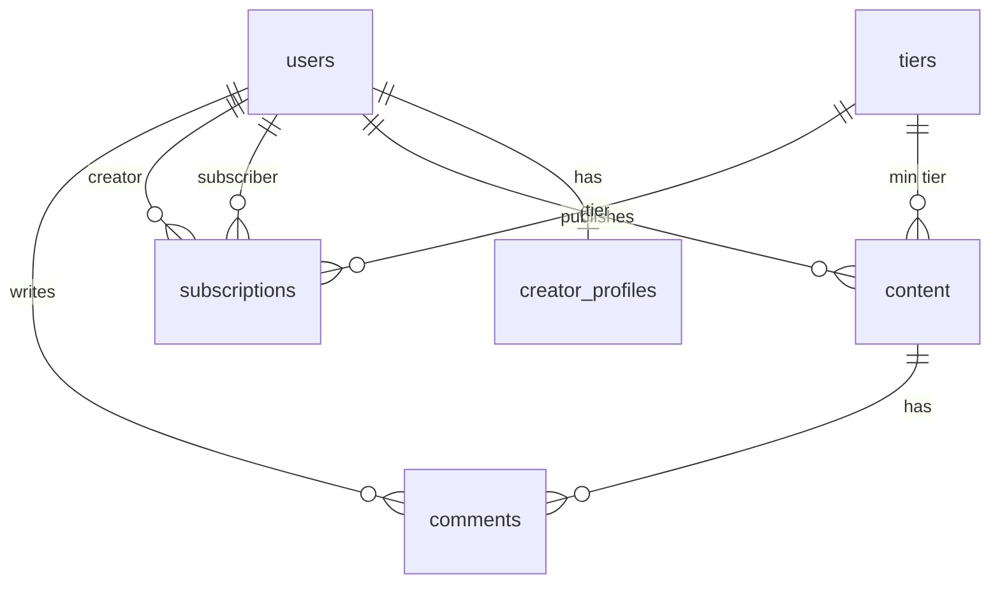

# CreatorHub: Creator Economy Platform

A subscription platform where creators publish tiered content and fans subscribe, unlock it, and chat live on every post. Think **Substack meets Patreon**.

Creators register, build a profile, and publish content locked to a tier (Free, Pro or VIP). Subscribers pick a tier, unlock what that tier allows, and join a real-time chat on each post. Payments are **mocked**: subscribing records a subscription without taking any money.

> **Status:** under active development, built in small working versions (see the [Roadmap](#roadmap)).

---

## Table of Contents

- [Features](#features)
- [Tech Stack](#tech-stack)
- [How Access Tiers Work](#how-access-tiers-work)
- [Project Structure](#project-structure)
- [Getting Started](#getting-started)
- [Environment Variables](#environment-variables)
- [NPM Scripts](#npm-scripts)
- [API Reference](#api-reference)
- [Database Schema](#database-schema)
- [Roadmap](#roadmap)
- [Git Workflow](#git-workflow)
- [Testing](#testing)
- [Team](#team)
- [License](#license)

---

## Features

**Core**
- Creator and subscriber registration, login and profiles
- Subscription tiers: **Free**, **Pro**, **VIP**
- Content publishing with rich text and file uploads
- Paywall: content is locked to a minimum tier
- Live chat and viewer count on every post (Socket.io)
- MySQL database for users, content, subscriptions and comments

**Planned additions**
- GraphQL content feed, filterable by tier and creator
- Media uploads to Cloudinary (thumbnails and compression)
- Email system: welcome email, new-post notification, weekly digest
- Live subscriber count on the creator dashboard (Firebase)
- Analytics dashboard and a trending-content algorithm

---

## Tech Stack

| Area | Technology |
|---|---|
| Runtime / server | Node.js 20+, Express |
| Database | MySQL 8, Sequelize ORM |
| Authentication | JWT, bcrypt |
| Real-time | Socket.io |
| Feed API | GraphQL |
| Media | Cloudinary |
| Email | Nodemailer, node-cron |
| Live dashboard data | Firebase |
| Testing | Jest, Supertest |
| CI/CD | GitHub Actions |

Each piece is introduced in the version that needs it, so the current code may not use everything listed here yet.

---

## How Access Tiers Work

Tiers are ranked, so a higher tier includes everything below it:

| Tier | Rank | Unlocks |
|---|---|---|
| Free | 0 | Free content |
| Pro | 1 | Free + Pro content |
| VIP | 2 | Free + Pro + VIP content |

Every content item has a `minTier`. A user can read the full content when:

```
userTier.rank >= content.minTier.rank
```

Users without access receive a preview (title and excerpt) instead of the full body. Enforcement arrives in **v0.3**. Before that, `minTier` is stored but not checked.

---

## Project Structure

```
.
├── src/
│   ├── app.js                 # Express app, middleware, route mounting
│   ├── server.js              # Starts the server, connects to the database
│   ├── config/                # Environment loading and DB config
│   ├── models/                # Sequelize models and associations
│   ├── migrations/            # Database schema changes (the only way schema changes)
│   ├── seeders/               # Tiers and demo data
│   ├── routes/                # auth, creators, content
│   ├── controllers/           # Request handling (no direct DB access)
│   ├── middleware/            # requireAuth, requireRole, validate, errorHandler, notFound
│   ├── store/                 # Data-access layer used by the controllers
│   └── utils/                 # JWT and password helpers, ApiError
├── scripts/
│   └── verify-associations.js # Checks that all model associations work
├── docs/
│   ├── ROADMAP.md
│   ├── PROGRESS.md
│   └── DB-SCHEMA.md
├── requests.http              # Ready-to-run sample requests
├── docker-compose.yml         # Optional MySQL 8 container
├── .env.example
└── README.md
```

> Controllers never import Sequelize models directly. All data access goes through `src/store/`.

---

## Getting Started

### Prerequisites

- **Node.js** 20 or newer
- **MySQL** 8, either installed locally or run with the included Docker file
- **Git**

### 1. Clone and install

```bash
git clone <your-repo-url>
cd creatorhub
npm install
```

### 2. Configure environment variables

```bash
cp .env.example .env
```

Open `.env` and fill in your values. See [Environment Variables](#environment-variables).

### 3. Start MySQL

**Option A: Docker (optional)**

```bash
docker compose up -d
```

**Option B: Local MySQL**

Install MySQL 8, create a user, and put its credentials in `.env`.

### 4. Set up the database

```bash
npm run db:reset
```

This drops and recreates the database, runs every migration, and loads the seed data (tiers and demo accounts).

### 5. Run the server

```bash
npm run dev
```

Check that it works:

```bash
curl http://localhost:3000/health
# {"status":"ok","db":"up"}
```

### Demo accounts

`npm run db:seed` creates demo creators and subscribers. The credentials are listed in the seeders folder and are **for local development only**. Never use them in production.

---

## Environment Variables

| Variable | Description | Example |
|---|---|---|
| `NODE_ENV` | Environment | `development` |
| `PORT` | Server port | `3000` |
| `JWT_SECRET` | Secret used to sign tokens (use a long random string) | `change-me` |
| `JWT_EXPIRES_IN` | Token lifetime | `1d` |
| `DB_HOST` | MySQL host | `localhost` |
| `DB_PORT` | MySQL port | `3306` |
| `DB_NAME` | Database name | `creatorhub` |
| `DB_USER` | Database user | `root` |
| `DB_PASSWORD` | Database password | `your-password` |
| `DB_LOGGING` | Print SQL queries to the console | `false` |

Later versions add variables for Cloudinary, SMTP email and Firebase. They will be added to `.env.example` as they arrive.

> Never commit `.env`. Only `.env.example` belongs in Git.

---

## NPM Scripts

| Script | What it does |
|---|---|
| `npm run dev` | Start the server with auto-reload |
| `npm start` | Start the server (production) |
| `npm run db:create` | Create the database |
| `npm run db:migrate` | Run all pending migrations |
| `npm run db:migrate:undo` | Roll back the last migration |
| `npm run db:seed` | Load tiers and demo data (safe to run more than once) |
| `npm run db:reset` | Drop, create, migrate and seed in one step |

---

## API Reference

Base URL: `http://localhost:3000`

Protected routes need a header: `Authorization: Bearer <token>`

### Auth

| Method | Endpoint | Access | Description |
|---|---|---|---|
| `POST` | `/api/auth/register` | Public | Register as `creator` or `subscriber` |
| `POST` | `/api/auth/login` | Public | Log in and receive a JWT |
| `GET` | `/api/auth/me` | Logged in | Get the current user |

### Creators

| Method | Endpoint | Access | Description |
|---|---|---|---|
| `GET` | `/api/creators/:id` | Public | View a creator's public profile |
| `PUT` | `/api/creators/me` | Creator | Update your bio and display name |

### Content

| Method | Endpoint | Access | Description |
|---|---|---|---|
| `POST` | `/api/content` | Creator | Create content (`title`, `body`, `minTier`) |
| `GET` | `/api/content` | Public | List content (paginated with `page` and `limit`) |
| `GET` | `/api/content/:id` | Public | Get one content item |
| `PUT` | `/api/content/:id` | Owner creator | Update your content |
| `DELETE` | `/api/content/:id` | Owner creator | Delete your content |

### System

| Method | Endpoint | Description |
|---|---|---|
| `GET` | `/health` | Server and database status |

### Example requests

**Register**

```bash
curl -X POST http://localhost:3000/api/auth/register \
  -H "Content-Type: application/json" \
  -d '{"name":"Asha","email":"asha@example.com","password":"password123","role":"creator"}'
```

**Log in**

```bash
curl -X POST http://localhost:3000/api/auth/login \
  -H "Content-Type: application/json" \
  -d '{"email":"asha@example.com","password":"password123"}'
```

**Create content** (creator token required)

```bash
curl -X POST http://localhost:3000/api/content \
  -H "Authorization: Bearer <token>" \
  -H "Content-Type: application/json" \
  -d '{"title":"My first post","body":"Hello fans!","minTier":"pro"}'
```

More ready-to-run requests are in [`requests.http`](./requests.http).

### Error format

Every error uses the same shape:

```json
{ "error": { "code": "VALIDATION_ERROR", "message": "Password must be at least 8 characters" } }
```

| Status | Meaning |
|---|---|
| `400` | Invalid input |
| `401` | Missing or invalid token, or wrong credentials |
| `403` | Not allowed (wrong role, or not the content owner) |
| `404` | Not found |
| `409` | Conflict (for example, email already registered) |
| `500` | Server error |

### Coming in later versions

- `POST /api/subscriptions` and tier-gated content responses (v0.3)
- Socket.io events for live comments and viewer count (v0.4)
- `POST /graphql` for the tiered content feed (v0.5)
- Media upload endpoints (v0.6)

---

## Database Schema



| Table | Purpose |
|---|---|
| `users` | Accounts for both creators and subscribers (`role`) |
| `creator_profiles` | Display name, bio and avatar for creators |
| `tiers` | Free, Pro and VIP with their rank and mock price |
| `content` | Posts, each with a minimum tier |
| `subscriptions` | Which subscriber follows which creator, at which tier |
| `comments` | Live chat messages on a post |

Full details are in [`docs/DB-SCHEMA.md`](./docs/DB-SCHEMA.md). The schema changes **only through migrations**, never through `sequelize.sync()`.

---

## Roadmap

The project ships in small, working versions. Tick them off as you tag each release.

- [ ] **v0.1**: Skeleton and auth (register, login, JWT, roles, content CRUD)
- [ ] **v0.2**: MySQL and Sequelize (schema, associations, migrations, seeds)
- [ ] **v0.3**: Subscriptions and paywall (mock subscribe, tier access control)
- [ ] **v0.4**: Live comments (Socket.io, viewer count, tier-gated rooms)
- [ ] **v0.5**: GraphQL feed (filter by tier and creator)
- [ ] **v0.6**: Media and security (Cloudinary, XSS sanitisation, rate limiting)
- [ ] **v0.7**: Email and Firebase (notifications, digest, live subscriber count)
- [ ] **v0.8**: Tests and CI/CD (integration tests, health check, auto-deploy)
- [ ] **v1.0**: Analytics dashboard, trending algorithm, final demo

Detailed notes are in [`docs/ROADMAP.md`](./docs/ROADMAP.md), and progress is tracked in [`docs/PROGRESS.md`](./docs/PROGRESS.md).

---

## Git Workflow

- `main` holds stable, tagged releases.
- `develop` is the integration branch.
- Work happens on `feature/<version>-<name>` branches created from `develop`.
- Open a pull request and get a teammate's review before merging.
- Use conventional commit messages: `feat:`, `fix:`, `chore:`, `docs:`.
- Tag each finished version on `main`, for example `git tag v0.2`.

---

## Testing

- **Until v0.8:** test manually with [`requests.http`](./requests.http) or `curl`.
- **From v0.8:**

  ```bash
  npm test
  ```

  Integration tests (Jest and Supertest) cover the subscription flow, and unit tests cover tier access control.

To check that the model associations work:

```bash
node scripts/verify-associations.js
```

---

## Team

| Name | Role |
|---|---|
| _Your name_ | _Your area_ |
| _Teammate_ | _Their area_ |

---

## License

Add your license here (for example MIT), or mark this as a coursework project.
