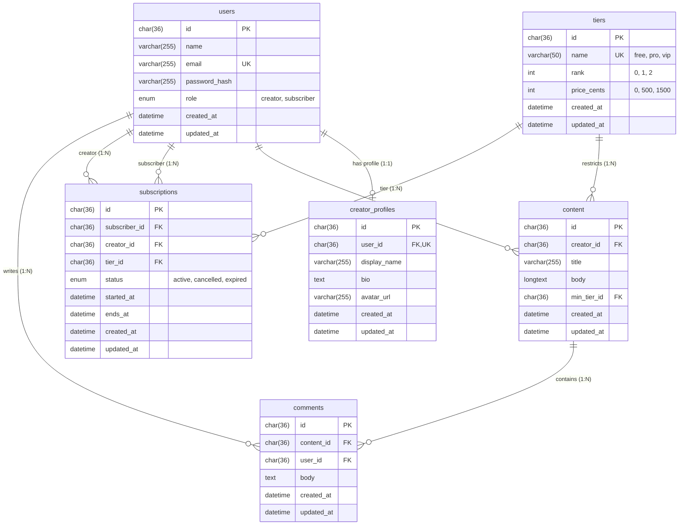

# CreatorHub Database Schema (v0.2)

This document provides the Entity-Relationship (ER) diagram, table descriptions, column definitions, and design decisions for the CreatorHub MySQL relational database.

---

## 1. Entity-Relationship (ER) Diagram

---

## 2. Table Descriptions

### `users`
Core user identity table supporting both `'creator'` and `'subscriber'` roles.
- `id`: UUID (`CHAR(36)`) primary key matching the API contract from v0.1.
- `email`: Normalized, case-insensitive unique index preventing duplicate registrations.
- `password_hash`: Bcrypt salted hash (cost 10+), never exposed in API responses.
- `role`: Restricted enum (`creator` or `subscriber`).

### `creator_profiles`
1-to-1 profile extension for users with the `'creator'` role.
- `user_id`: Unique foreign key referencing `users(id)` with `ON DELETE CASCADE`. Subscribers have no record in this table.
- `display_name`: Public creator name.
- `bio`: Creator biography / channel introduction.
- `avatar_url`: Reserved placeholder for Cloudinary uploads in v0.6.

### `tiers`
Platform-wide reference table establishing subscription tiers and ordering.
- `name`: Unique name (`'free'`, `'pro'`, `'vip'`).
- `rank`: Numeric hierarchy (`0` for Free, `1` for Pro, `2` for VIP) enabling comparative tier gating in v0.3 (`fanTier.rank >= post.minTier.rank`).
- `price_cents`: Simulated monthly price in cents.

### `content`
Posts published by creators.
- `creator_id`: Foreign key referencing `users(id)` with `ON DELETE CASCADE`.
- `min_tier_id`: Foreign key referencing `tiers(id)` indicating minimum required access tier.
- **Indexes**:
  - `idx_content_creator_created_at` (`creator_id`, `created_at` DESC) optimizes fetching a creator's posts chronologically.
  - `idx_content_min_tier_id` (`min_tier_id`) optimizes tier-filtered feed queries.

### `subscriptions` (Schema prepared for v0.3)
Records subscriber memberships to specific creators.
- `subscriber_id`: Foreign key referencing `users(id)` (the paying subscriber).
- `creator_id`: Foreign key referencing `users(id)` (the content creator).
- `tier_id`: Foreign key referencing `tiers(id)`.
- Unique constraint: `(subscriber_id, creator_id)` ensures a subscriber cannot have multiple conflicting subscriptions to the same creator.

### `comments` (Schema prepared for v0.4)
Discussion comments published under content posts.
- `content_id`: Foreign key referencing `content(id)` with `ON DELETE CASCADE`.
- `user_id`: Foreign key referencing `users(id)` with `ON DELETE CASCADE`.
- **Index**: `idx_comments_content_created_at` (`content_id`, `created_at`) enables efficient loading of chronological comment threads per post.

---

## 3. Key Design Decisions

1. **UUID Primary Keys (`CHAR(36)`)**:
   - Maintains exact backward compatibility with v0.1 client expectations and route parameter validation (`z.string().uuid()`).
   - Prevents sequential ID guessing attacks across posts, creators, and subscribers.

2. **Decoupled Repository Pattern**:
   - Controllers never interact directly with Sequelize models. All database operations are channeled through `src/store/userStore.js` and `src/store/contentStore.js`.
   - Allows future optimization (e.g. caching with Redis) without touching routing or presentation layers.

3. **Transactional Creator Creation**:
   - Registering a user with `role === 'creator'` performs an atomic insert across `users` and `creator_profiles` inside a single managed transaction (`sequelize.transaction`). If either fails, neither is committed.

4. **Tier Mapping in Store Layer**:
   - The database stores normalized `min_tier_id` referencing the `tiers` table. The repository layer automatically translates incoming string names (`"free"`, `"pro"`, `"vip"`) to foreign keys on write, and extracts `item.minTier.name` on read, preserving the external API contract.

5. **Elimination of N+1 Queries**:
   - Content listings use Sequelize eager loading (`include: [{ model: Tier, as: 'minTier' }, { model: User, as: 'creator', include: [{ model: CreatorProfile, as: 'profile' }] }]`), resolving content and creator details in a single query.
