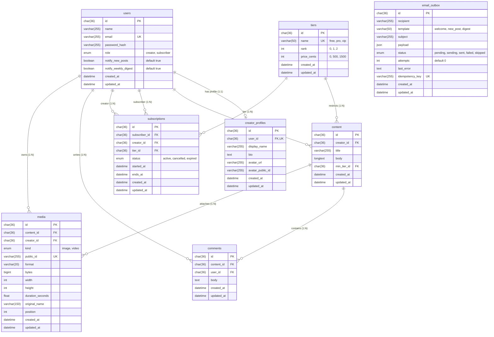

# CreatorHub Database Schema (v0.7)

This document provides the Entity-Relationship (ER) diagram, table descriptions, column definitions, and design decisions for the CreatorHub MySQL relational database.

---

## 1. Entity-Relationship (ER) Diagram

---

## 2. Table Descriptions

### `users`
Core user identity table supporting both `'creator'` and `'subscriber'` roles.
- `id`: UUID (`CHAR(36)`) primary key.
- `email`: Normalized unique index preventing duplicate registrations.
- `password_hash`: Bcrypt salted hash, never exposed in API responses.
- `role`: Restricted enum (`creator` or `subscriber`).
- `notify_new_posts`: Boolean (default `true`) indicating opt-in preference for new post notification emails.
- `notify_weekly_digest`: Boolean (default `true`) indicating opt-in preference for weekly summary digest emails.

### `creator_profiles`
1-to-1 profile extension for users with the `'creator'` role.
- `user_id`: Unique foreign key referencing `users(id)` with `ON DELETE CASCADE`.
- `display_name`: Public creator name.
- `bio`: Creator biography / channel introduction.
- `avatar_url`: Public delivery URL for creator's avatar.
- `avatar_public_id`: Cloudinary public identifier for the avatar asset, used for asset replacement/deletion cleanup.

### `tiers`
Platform-wide reference table establishing subscription tiers and ordering.
- `name`: Unique name (`'free'`, `'pro'`, `'vip'`).
- `rank`: Numeric hierarchy (`0` for Free, `1` for Pro, `2` for VIP).
- `price_cents`: Simulated monthly price in cents.

### `content`
Posts published by creators.
- `creator_id`: Foreign key referencing `users(id)` with `ON DELETE CASCADE`.
- `min_tier_id`: Foreign key referencing `tiers(id)`.
- **Indexes**:
  - `idx_content_creator_created_at` (`creator_id`, `created_at` DESC).
  - `idx_content_min_tier_id` (`min_tier_id`).

### `media` (Added in v0.6)
Media assets (images and videos) attached to content posts.
- `content_id`: Foreign key referencing `content(id)` with `ON DELETE CASCADE`.
- `creator_id`: Foreign key referencing `users(id)` with `ON DELETE CASCADE`.
- `kind`: Media category (`image` or `video`).
- `public_id`: Cloudinary storage identifier (authenticated asset path; strictly hidden from client API responses).
- `format`: Asset file format (`png`, `jpg`, `mp4`, `webm`).
- `bytes`: File size in bytes.
- `width`, `height`: Visual dimensions.
- `duration_seconds`: Video duration.
- `original_name`: Sanitized original filename for display.
- `position`: Integer attachment order.
- **Indexes**:
  - `idx_media_content_position`: `(content_id, position)`
  - `idx_media_creator`: `(creator_id)`

### `subscriptions`
Records subscriber memberships to specific creators.
- Unique constraint: `(subscriber_id, creator_id)`.

### `comments`
Discussion comments published under content posts.
- `content_id`: Foreign key referencing `content(id)` with `ON DELETE CASCADE`.
- `user_id`: Foreign key referencing `users(id)` with `ON DELETE CASCADE`.
- **Index**: `idx_comments_content_created_at` (`content_id`, `created_at`).

### `email_outbox` (Added in v0.7)
Transactional outbox table for reliable asynchronous email delivery and send-time verification.
- `id`: UUID (`CHAR(36)`) primary key.
- `recipient`: Target email address (`VARCHAR(255)`).
- `template`: Email template identifier (`welcome`, `new_post`, `digest`).
- `subject`: Email subject line (CR/LF sanitized).
- `payload`: Structured JSON containing metadata, template variables, and access-check parameters (`subscriberId`, `creatorId`, `contentId`, `minTierId`).
- `status`: Outbox row lifecycle state (`pending`, `sending`, `sent`, `failed`, `skipped`).
- `attempts`: Count of delivery attempts before permanent failure.
- `last_error`: Text details of transient error or skip reason (e.g. `access_revoked`, `opted_out`).
- `idempotency_key`: Unique string token (e.g., `welcome:${subId}:${creatorId}`, `digest:${userId}:${isoWeek}`) preventing duplicate sends.
- **Indexes**:
  - `idx_email_outbox_status_created`: `(status, created_at)`
  - `idx_email_outbox_idempotency_key`: `(idempotency_key)` UNIQUE

---

## 3. Key Design Decisions

1. **UUID Primary Keys (`CHAR(36)`)**: Maintains exact backward compatibility and prevents sequential ID guessing attacks.
2. **Decoupled Store Layer**: Controllers and GraphQL resolvers never import Sequelize models directly; all database interactions are encapsulated in `src/store/`.
3. **Atomic Quotas & Row Locks**: Media attachment limits ($\le 5$) and creator quotas ($\le 200$ MB) are enforced with `SELECT ... FOR UPDATE` row locks inside managed transactions to eliminate race conditions under parallel uploads.
4. **Cascade Asset Cleanup**: Database foreign keys enforce cascade deletion. When a post or creator is deleted, the storage layer destroys corresponding assets on Cloudinary.
5. **Transactional Outbox & Send-Time Checks**: All outbound notifications are committed to MySQL within domain event listeners, decoupled from the incoming client request. Worker polls with `SELECT ... FOR UPDATE SKIP LOCKED` and re-verifies active tier access right before transmission, guaranteeing zero data leakage even under concurrent cancellation.
