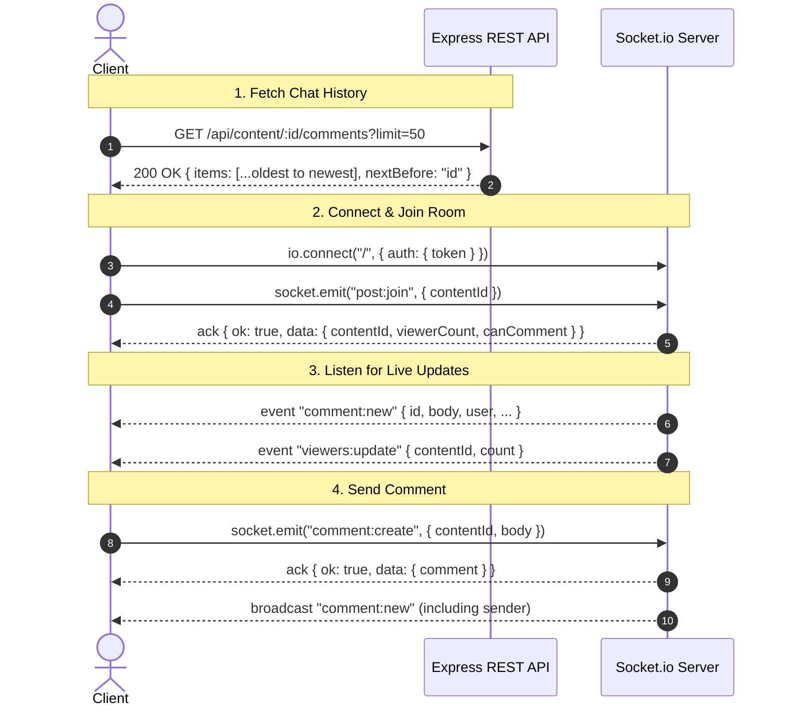

# Realtime Socket.io Specification (v0.4)

This document provides the complete client contract for interacting with CreatorHub's real-time service. It covers handshake authentication, room joining, chat history, live messaging, distinct viewer counting, rate limiting, and live access revocation.

---

## 1. Connection & Handshake Authentication

### Transport & URL
- Socket.io attaches to the HTTP API server on the same host and port (`PORT=5000`).
- Connect using the standard Socket.io client:
  ```javascript
  import { io } from 'socket.io-client';

  const socket = io('http://localhost:5000', {
    auth: {
      token: '<JWT_TOKEN>' // Optional: Omit or pass null for Anonymous mode
    }
  });
  ```
- **Security Rule**: Tokens are accepted strictly via `{ auth: { token } }`. Query string tokens (`?token=...`) are rejected to avoid appearing in server access logs.

### Handshake Authentication Rules
| Auth State | Handshake Behavior | Privileges |
| :--- | :--- | :--- |
| **No token provided** | Allowed as `ANONYMOUS` | Read-only. Can join Free post rooms and view live chat & viewer counts. Cannot post comments. |
| **Valid JWT provided** | Connected as authenticated user | Joins personal room `user:{id}`. Can post comments in any joined room where viewer has paywall access. |
| **Malformed token** | Connection rejected with `INVALID_TOKEN` | Error message received in `connect_error`. |
| **Expired token** | Connection rejected with `TOKEN_EXPIRED` | Error message received in `connect_error`. Client must refresh token. |

---

## 2. Event Contract

Every client-to-server event uses an acknowledgement callback adhering to this shape:
- **Success**: `{ ok: true, data: { ... } }`
- **Failure**: `{ ok: false, error: { code: string, message: string, details?: object } }`

### Client -> Server Events

#### `post:join`
Join the real-time room for a specific post.
- **Payload**:
  ```json
  {
    "contentId": "c1111111-1111-4111-8111-111111111111"
  }
  ```
- **Acknowledgement on Success**:
  ```json
  {
    "ok": true,
    "data": {
      "contentId": "c1111111-1111-4111-8111-111111111111",
      "viewerCount": 5,
      "canComment": true
    }
  }
  ```
- **Errors**:
  - `NOT_FOUND`: Post does not exist.
  - `TIER_REQUIRED`: User/anonymous tier is insufficient for post minTier. Includes `details: { requiredTier, viewerTier }`.
  - `ROOM_LIMIT`: Socket has reached maximum limit of 10 concurrently joined rooms.
  - `VALIDATION_ERROR`: Invalid or missing `contentId`.
- **Note**: Joining a room you are already in is idempotent (succeeds without incrementing presence).

---

#### `post:leave`
Leave a previously joined post room.
- **Payload**:
  ```json
  {
    "contentId": "c1111111-1111-4111-8111-111111111111"
  }
  ```
- **Acknowledgement on Success**:
  ```json
  {
    "ok": true,
    "data": {
      "contentId": "c1111111-1111-4111-8111-111111111111"
    }
  }
  ```
- **Errors**:
  - `VALIDATION_ERROR`: Invalid or missing `contentId`.

---

#### `comment:create`
Post a new live comment to a room.
- **Requirements**:
  1. Connected with an authenticated account.
  2. JWT token has not expired mid-session.
  3. Socket is currently a member of `post:{contentId}`.
  4. Active paywall access re-verified against live database.
- **Payload**:
  ```json
  {
    "contentId": "c1111111-1111-4111-8111-111111111111",
    "body": "Great insights on distributed consensus!"
  }
  ```
- **Acknowledgement on Success**:
  ```json
  {
    "ok": true,
    "data": {
      "comment": {
        "id": "c1000000-0000-0000-0000-000000000001",
        "contentId": "c1111111-1111-4111-8111-111111111111",
        "body": "Great insights on distributed consensus!",
        "createdAt": "2026-10-30T10:00:00.000Z",
        "user": {
          "id": "a0000001-aaaa-4aaa-8aaa-aaaaaaaaaaaa",
          "name": "Subscriber A (VIP)",
          "role": "subscriber"
        }
      }
    }
  }
  ```
- **Errors**:
  - `UNAUTHENTICATED`: Anonymous connections cannot comment.
  - `TOKEN_EXPIRED`: JWT expired mid-session. Reconnect with refreshed token.
  - `NOT_IN_ROOM`: Must call `post:join` before posting comments.
  - `RATE_LIMITED`: Exceeded 5 comments per 10 seconds per socket.
  - `TIER_REQUIRED`: Subscription was cancelled or downgraded since joining.
  - `VALIDATION_ERROR`: Empty, whitespace-only, or > 1000 character comment body.

---

### Server -> Client Broadcast Events

#### `comment:new`
Broadcast to the entire room (`post:{contentId}`) when any viewer creates a comment, **including the sender**.
- **Payload**:
  ```json
  {
    "id": "c1000000-0000-0000-0000-000000000001",
    "contentId": "c1111111-1111-4111-8111-111111111111",
    "body": "Plain text comment content",
    "createdAt": "2026-10-30T10:00:00.000Z",
    "user": {
      "id": "a0000001-aaaa-4aaa-8aaa-aaaaaaaaaaaa",
      "name": "Subscriber A (VIP)",
      "role": "subscriber"
    }
  }
  ```
- **Client Handling**: Deduplicate by `comment.id`. Always render `body` as plain text.

---

#### `viewers:update`
Broadcast to the room (`post:{contentId}`) whenever the count of distinct viewers changes.
- **Payload**:
  ```json
  {
    "contentId": "c1111111-1111-4111-8111-111111111111",
    "count": 4
  }
  ```
- **Note**: Distinct viewers are counted. Opening multiple browser tabs with the same account counts as 1 viewer. The event is only emitted when the count actually changes.

---

#### `access:revoked`
Sent directly to an individual socket when their access to a post is revoked while sitting in an active room.
- **Payload**:
  ```json
  {
    "contentId": "c1111111-1111-4111-8111-111111111111",
    "reason": "SUBSCRIPTION_CHANGED" | "TIER_REQUIREMENT_CHANGED"
  }
  ```
- **Client Handling**: The socket has been automatically evicted from the room on the server. Disable comment inputs and notify the user.

---

#### `post:deleted`
Broadcast to all sockets in `post:{contentId}` when the post is deleted by its creator.
- **Payload**:
  ```json
  {
    "contentId": "c1111111-1111-4111-8111-111111111111"
  }
  ```
- **Client Handling**: All sockets are removed from the room. Close the chat view.

---

## 3. Recommended Frontend Client Flow



---

## 4. Error Codes Reference

| Error Code | HTTP Status | Context | Description |
| :--- | :--- | :--- | :--- |
| `UNAUTHENTICATED` | 401 | Handshake / comment:create | Authentication required. Anonymous users cannot write comments. |
| `INVALID_TOKEN` | 401 | Handshake | JWT signature is invalid or user record no longer exists. |
| `TOKEN_EXPIRED` | 401 | Handshake / comment:create | JWT has expired. |
| `TIER_REQUIRED` | 403 | REST History / post:join / comment:create | Higher tier subscription required. Details specify `requiredTier` and `viewerTier`. |
| `NOT_FOUND` | 404 | REST History / post:join | Requested content ID does not exist. |
| `VALIDATION_ERROR` | 400 | REST History / Sockets | Payload missing fields, body < 1 or > 1000 chars, or whitespace-only. |
| `NOT_IN_ROOM` | 400 | comment:create | Must join the room via `post:join` before sending comments. |
| `ROOM_LIMIT` | 429 | post:join | Exceeded maximum of 10 concurrently joined rooms per socket. |
| `RATE_LIMITED` | 429 | comment:create | Exceeded limit of 5 comments per 10 seconds per socket. |
| `INTERNAL_ERROR` | 500 | General | Unexpected internal server error. Raw error details are not leaked. |
